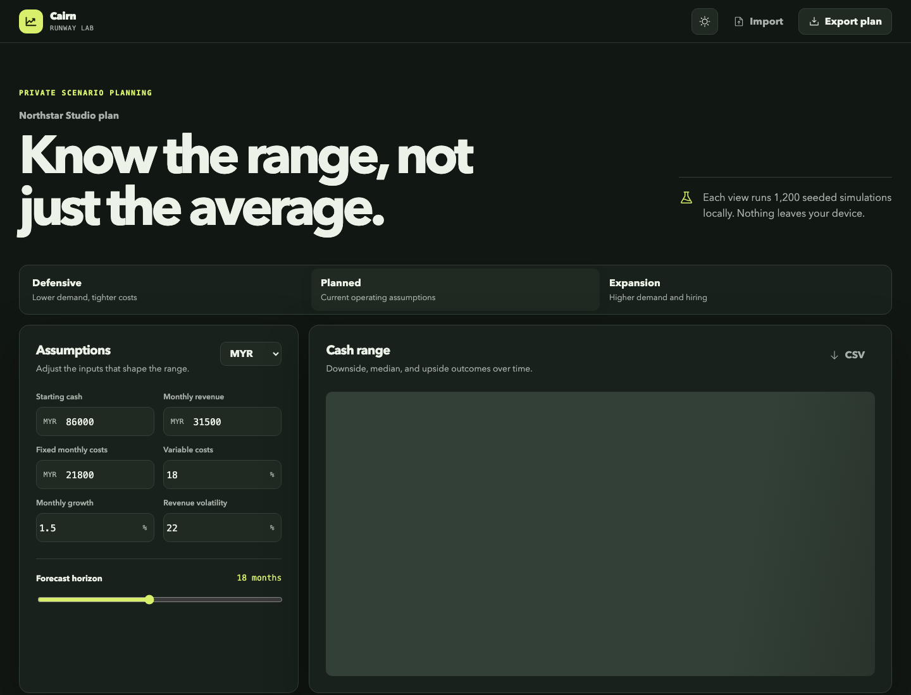
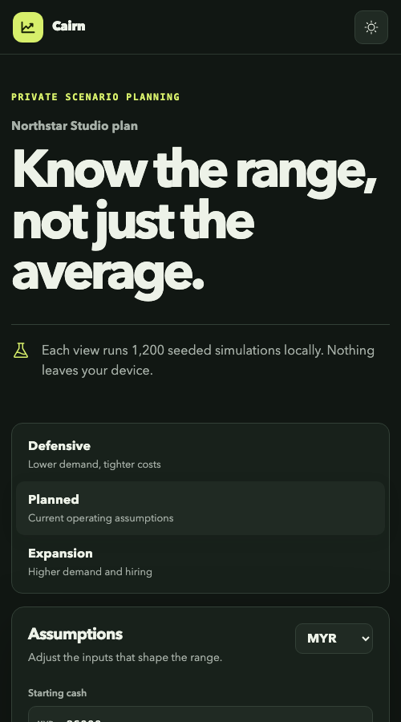

# Cairn Runway



Cairn is a private cash-runway planning lab for independent studios and small service businesses. It replaces a misleading single forecast with a visible range of outcomes, using seeded Monte Carlo simulation to show downside, median, and upside cash paths.

The application runs entirely in the browser. Plans are stored locally, simulations run in a Web Worker, and no financial data is uploaded.

## Why this project exists

Most runway calculators assume that next month looks exactly like the spreadsheet. Cairn treats revenue as a distribution, then makes the resulting uncertainty useful enough to act on. An operator can tune the plan, compare three operating modes, inspect survival probability, and export both the plan and forecast.

## Product flow

1. Start from realistic sample assumptions or clear the workspace and build a plan from zero.
2. Set cash, revenue, fixed costs, variable costs, growth, volatility, currency, and forecast horizon.
3. Compare Defensive, Planned, and Expansion modes.
4. Review the cash-range chart and decision signals.
5. Export the plan as JSON or the projection as CSV; import the JSON later on the same or another device.

## Features

- 1,200 deterministic Monte Carlo trials per valid plan
- P10, median, and P90 cash trajectories
- Scenario-specific revenue, cost, and volatility adjustments
- Survival probability, median runway, and lowest median cash signals
- Strict inline validation for financial assumptions
- Responsive light and dark themes with system preference support
- Local persistence with a clear empty state and sample-data path
- JSON plan import/export and CSV projection export
- Worker-isolated calculation to keep editing responsive
- Loading, empty, success, validation, worker-failure, and import-error states
- Keyboard focus treatment, semantic labels, reduced-motion support, and an accessible chart description

## Technology

- React 19 and TypeScript 6
- Vite 8
- Chart.js 4
- Web Workers
- Phosphor Icons
- Vitest, ESLint 10, and Prettier
- GitHub Actions CI

## Architecture

```text
User inputs
    |
    v
React plan state ---> localStorage / JSON export
    |
    v
simulation.worker.ts
    |
    v
Seeded Monte Carlo engine (domain.ts)
    |
    +--> percentile chart model
    +--> survival and runway signals
    +--> CSV export
```

The financial model is framework-independent in `src/domain.ts`. The worker is a thin message boundary, while React owns interaction and persistence. This separation makes the simulation directly testable and keeps UI rendering independent from compute work.

## Setup

Requirements: Node.js 22 or newer and npm 10 or newer.

```bash
git clone https://github.com/Decker7/cairn-runway.git
cd cairn-runway
npm install
npm run dev
```

Vite prints the local URL after startup.

## Commands

| Command                | Purpose                                     |
| ---------------------- | ------------------------------------------- |
| `npm run dev`          | Start the development server                |
| `npm run build`        | Type-check and create the production bundle |
| `npm run preview`      | Preview the production bundle               |
| `npm test`             | Run domain tests once                       |
| `npm run lint`         | Run ESLint with zero warnings allowed       |
| `npm run typecheck`    | Run strict TypeScript project checks        |
| `npm run format`       | Format the repository                       |
| `npm run format:check` | Verify formatting without edits             |

## Verification

The release was checked with:

```bash
npm run format:check
npm run lint
npm run typecheck
npm test
npm run build
npm audit --omit=dev
```

Current test suite: 5 passing domain tests. The rendered production experience also scored 100 for Performance, Accessibility, and Best Practices in a local Lighthouse audit.

## Responsive preview



## Privacy and security

- No analytics, accounts, API keys, or backend service
- No financial information leaves the browser
- Imports are parsed and validated before replacing the active plan
- `.env` files, local overrides, coverage, dependencies, and build output are ignored

## Limitations

- Cairn is a planning aid, not accounting or financial advice.
- The simulation uses a compact normal-distribution revenue model; it does not model seasonality, taxes, debt schedules, or correlated shocks.
- Browser storage is device-local and is not a backup. Export important plans as JSON.
- Multiple plans are not indexed simultaneously in this release.

## Future opportunities

- Seasonal and contract-specific revenue schedules
- Headcount and one-off expense events
- Side-by-side scenario comparison
- Encrypted multi-plan vault and optional sync
- Sensitivity analysis showing which input most changes runway
- PDF board-report export

## License

[MIT](LICENSE)
